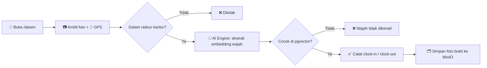

<div align="center">

# 🕒 HadirYuk

**Sistem absensi berbasis pengenalan wajah + geofencing GPS**

Karyawan cukup buka kamera, wajah dikenali, lokasi dicek, presensi tercatat. Tanpa kartu, tanpa kunjungan ke mesin fingerprint.


</div>

---

## ✨ Fitur

| | Fitur | Keterangan |
|---|---|---|
| 🧑‍💼 | **Pengenalan wajah** | InsightFace (`buffalo_l`), embedding 512 dimensi, dicocokkan lewat pgvector |
| 📍 | **Geofencing GPS** | Presensi hanya sah di dalam radius kantor (bisa lebih dari satu lokasi) |
| ⏱️ | **Auto clock-in / clock-out** | Absen pertama hari itu = masuk, absen berikutnya = pulang |
| 📊 | **Dashboard admin** | Ringkasan presensi hari ini, log real-time, kelola karyawan |
| 🏢 | **Kelola lokasi kantor** | Atur titik koordinat dan radius langsung dari UI |
| 📑 | **Laporan & ekspor CSV** | Filter berdasarkan tanggal dan nama |
| 🔐 | **Login admin** | Session JWT (HS256), terpisah dari data karyawan |
| 🩺 | **Monitoring sistem** | Status DB, MinIO, dan AI Engine secara real-time |

---

## 🧱 Tech Stack

| Lapisan | Teknologi |
|---|---|
| **Frontend + Backend** | Next.js 15 (App Router), TypeScript, Tailwind CSS |
| **AI Engine** | FastAPI, InsightFace, ONNX Runtime (CPU), OpenCV |
| **Database** | PostgreSQL + pgvector (`pg`, tanpa ORM) |
| **Object storage** | MinIO (S3-compatible) untuk foto bukti presensi |
| **Auth** | `jose` (JWT) |
| **Deploy** | Docker Compose |

---

## 🔄 Alur Presensi



---

## 🚀 Menjalankan dengan Docker

```bash
git clone https://github.com/dentowahyuu/NAMA-REPO.git
cd NAMA-REPO

cp .env.example .env
# isi ADMIN_SESSION_SECRET (wajib) dan ganti password default:
#   node -e "console.log(require('crypto').randomBytes(32).toString('hex'))"

docker compose up -d --build
```

Setelah semua container sehat:

| Halaman | URL |
|---|---|
| 🎯 Kiosk absen | http://localhost:3000/absen |
| 🛠️ Dashboard admin | http://localhost:3000/admin |
| 🤖 AI Engine (health) | http://localhost:8000/health |
| 🗄️ MinIO console | http://localhost:9001 |

Saat pertama kali membuka `/admin`, form **"Buat Akun Admin"** muncul otomatis. Isi username dan password sendiri.

> ⚠️ Browser hanya mengizinkan akses **kamera dan GPS** lewat **HTTPS** atau `localhost`. Kalau diakses dari HP lewat IP jaringan lokal (`http://192.168.x.x`), fitur ini diblokir diam-diam. Untuk produksi, pakai HTTPS (misalnya Cloudflare Tunnel).

---

## 💻 Development Lokal (tanpa Docker)

Butuh PostgreSQL (dengan extension `pgvector`) dan MinIO yang jalan sendiri.

```bash
# 1. Siapkan AI engine
cd apps/ai-engine
python -m venv venv
venv\Scripts\pip install -r requirements.txt     # Windows
# venv/bin/pip install -r requirements.txt       # Linux / Mac
cd ../..

# 2. Isi apps/web/.env.local (lihat tabel env di bawah)

# 3. Jalankan web (3000) + AI engine (8000) sekaligus
npm install
npm run dev
```

---

## 🔧 Environment Variables

**Docker Compose** (dibaca dari `.env` di root):

| Variabel | Fungsi |
|---|---|
| `POSTGRES_USER` / `POSTGRES_PASSWORD` / `POSTGRES_DB` | Kredensial database |
| `MINIO_ROOT_USER` / `MINIO_ROOT_PASSWORD` | Kredensial MinIO |
| `FACE_MATCH_THRESHOLD` | Batas minimum kemiripan wajah (default `0.5`) |
| `ADMIN_SESSION_SECRET` | **Wajib.** Secret penanda token admin |

**Dev lokal** (`apps/web/.env.local`): `DATABASE_URL`, `MINIO_ENDPOINT`, `MINIO_PORT_INTERNAL`, `MINIO_ACCESS_KEY`, `MINIO_SECRET_KEY`, `AI_ENGINE_URL`. Contoh lengkap ada di `.env.example`.

> 🔒 Password default di `.env.example` hanya untuk percobaan lokal. Ganti semuanya sebelum dipakai di server yang bisa diakses orang lain.

---

## 📁 Struktur Folder

```
├── docker-compose.yml
├── config/init-db.sql          # skema database
└── apps/
    ├── ai-engine/              # FastAPI + InsightFace
    └── web/                    # Next.js (UI + API routes)
        └── src/
            ├── lib/            # db, minio, klien AI engine, auth, geo
            └── app/
                ├── absen/      # halaman kiosk presensi (publik)
                ├── admin/      # login, dashboard, kantor, laporan
                └── api/        # attendance, users, offices, logs, auth, health
```

---

## 🔌 Ringkasan API

**AI Engine** (port 8000, internal)

| Endpoint | Fungsi |
|---|---|
| `GET /health` | Status model |
| `POST /extract-embedding` | Foto menjadi embedding wajah 512 dimensi |

**Web** (Next.js)

| Endpoint | Akses | Fungsi |
|---|---|---|
| `POST /api/attendance` | Publik | Alur inti presensi |
| `GET/POST /api/users`, `PATCH/DELETE /api/users/[id]` | Admin | Kelola karyawan |
| `GET/POST /api/offices`, `PATCH/DELETE /api/offices/[id]` | Admin | Kelola lokasi kantor |
| `GET /api/logs` | Admin | Data log presensi |
| `GET /api/system/health` | Admin | Status DB / MinIO / AI Engine |

---

## 🧠 Catatan Teknis

- **Tanpa index ANN di pgvector.** Index approximate (ivfflat/hnsw) bisa gagal menemukan wajah yang sebenarnya cocok saat data masih sedikit. Dengan puluhan sampai ratusan karyawan, pencarian *exact* sudah cukup cepat dan hasilnya benar.
- **Threshold kemiripan `0.5`.** Wajah yang sama di kondisi pengambilan berbeda biasanya berkisar 0.55 sampai 0.82, sedangkan orang berbeda hanya sekitar 0.01 sampai 0.1. Margin selebar itu membuat 0.5 aman, dan bisa di-tuning lewat env.
- **Akurasi GPS di dalam gedung** bisa meleset 20 sampai 50 meter. Kalau banyak yang gagal absen padahal di kantor, longgarkan radius lewat halaman **Admin → Lokasi Kantor** tanpa mengubah kode.

---

<div align="center">

Dibuat dengan ☕ oleh [@dentowahyuu](https://github.com/dentowahyuu)

</div>
